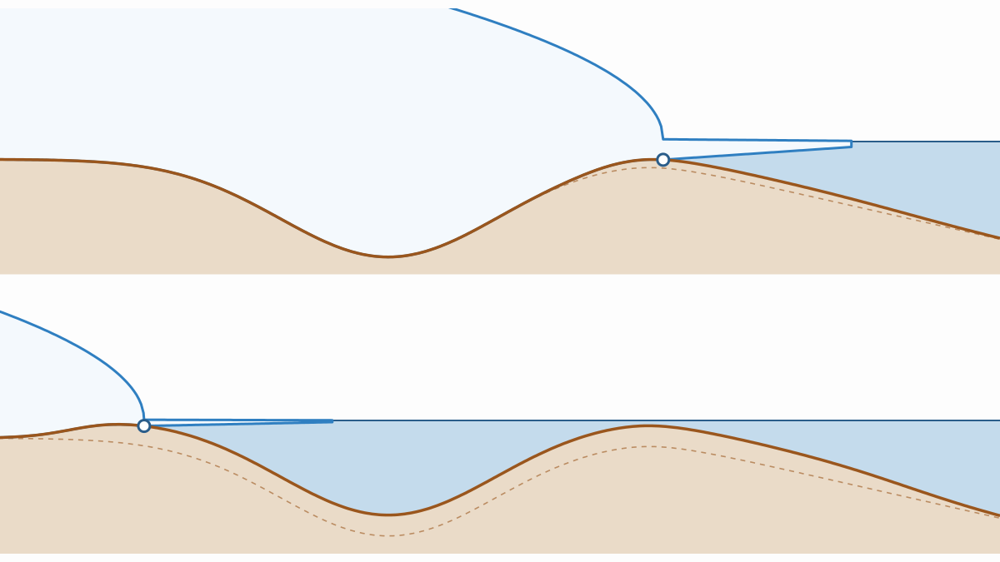

::: {.hl-numbers}
::: {.hl-number}
[up to 0.5 °C]{.hl-number-value}
[less global warming needed to collapse the Recovery and Aurora basins]{.hl-number-label}
:::
::: {.hl-number}
[~0.07 °C]{.hl-number-value}
[per century: a warming rate already fast enough for the full effect in the Recovery basin]{.hl-number-label}
:::
::: {.hl-number}
[~7 m]{.hl-number-value}
[sea-level equivalent of ice held in the Recovery and Aurora basins]{.hl-number-label}
:::
:::

<noscript></noscript>

::: {.rt-caption}
A toy marine ice sheet under the same warming in both panels. Only the response time of the mantle differs (200 years above, 10,000 years below). With a soft mantle, the bed rises fast enough to hold the grounding line at the sill. With a stiff mantle, the grounding line passes the sill before the bed has risen and retreats into the basin.
:::

## Tipping before the tipping point

Large parts of the Antarctic ice sheet rest on bedrock below sea level. The West Antarctic ice sheet and the East Antarctic subglacial basins hold about 4.3 m and 19 m of sea-level equivalent, respectively. Where the bed deepens towards the interior, a retreating grounding line (i.e., where the ice starts to float) meets thicker ice, which increases the ice outflow and drives further retreat. This marine ice-sheet instability makes the retreat self-sustained beyond a critical warming, the so-called bifurcation point.

The solid Earth acts against this instability. As the ice thins, the bedrock rises and the water depth at the grounding line decreases, which reduces the outflow. In equilibrium simulations, this glacial isostatic adjustment can hold the grounding line on a sill that would otherwise be crossed. However, the bedrock rises on a timescale set by the viscosity of the mantle. This viscosity varies by orders of magnitude across Antarctica: the mantle is soft below West Antarctica and stiff below the old East Antarctic craton (Fig. 1e–g).

The timing of the uplift is therefore important. If the ice retreats faster than the bedrock rises, the grounding line can reach the retrograde slope before the uplift stabilizes it (Fig. 1a–c). The basin then collapses even though the warming remains below its bifurcation point. This is rate-induced tipping: whether the system tips depends on how fast the forcing changes, and not only on how much.

.]{.hl-credit}](fig1.png){fig-alt="Schematic of grounding-zone retreat with fast and slow bedrock uplift, and maps of lithospheric thickness and mantle viscosity of Antarctica"}

## What the simulations show

We coupled the ice-sheet model Yelmo to FastIsostasy, a regional model of glacial isostatic adjustment that resolves the lateral variations of the lithosphere and mantle. We sampled the uncertainty in mantle viscosity with five fields, from 2σ below to 2σ above the nominal estimate. The experiments add up to about 100 Myr of model time at 16 km resolution. This large number of simulations was needed to study the system systematically for different warming levels, warming rates and mantle viscosities. It is only feasible because FastIsostasy is several orders of magnitude faster than conventional 3D models of glacial isostatic adjustment.

Rate-induced tipping is absent in West Antarctica and substantial in East Antarctica. Quasi-equilibrium simulations first give the bifurcation points of the five largest marine basins. Forcing steps and ramps then give the lowest warming that collapses each basin. The difference between the two is zero for the West Antarctic ice sheet, up to about 0.15 °C for the Wilkes basin and up to 0.3 °C and 0.4 °C for the Recovery and the inner Aurora basin, respectively. In addition, a stiffer mantle lowers the bifurcation point itself by up to about 0.2 °C. Compared with the bifurcation point for the softest mantle, the critical warming of the Recovery and Aurora basins thus decreases by up to 0.5 °C in total.

The difference between West and East stems from the mantle viscosity and from the magnitude of the uplift before the instability sets in. Below West Antarctica, the mantle is soft, the ice thins little before the onset of retreat and the bedrock rises by only about 1.5 m over the first few thousand years. In the Recovery and Aurora basins, it rises by up to 150–170 m over the same period, so a delay of this uplift has a large effect. This suggests a general rule: a delayed stabilizing feedback can only cause rate-induced tipping if, without the delay, it would already act strongly before the instability sets in. For the Antarctic basins, this means a bedrock uplift on the order of 100 m before the onset of retreat, rather than a few metres.

The warming rate needed is small. In the Recovery basin, the full effect is reached at about 0.07 °C per century, since the ice sheet itself cannot retreat faster than its own dynamics allow. The mean warming rate since pre-industrial times is about 1 °C per century, and high-emission scenarios reach about 5 °C per century. Thresholds derived from equilibrium simulations thus likely overestimate the warming that the Recovery and Aurora basins can sustain. Crossing such a threshold, however, does not imply an immediate collapse. The retreat unfolds over millennia and could be avoided by a sufficiently fast return to cooler conditions.

## Try it yourself

The model below is a toy version of the mechanism. It represents a single grounding line on a bed with a sill and a deep basin inland, with a bedrock that rises with a delay. Each run starts from the same present-day state, warms at the chosen rate up to the chosen level and then holds that level. Start with the stiff mantle at 2.9 °C and 1 °C per century, then switch to the soft mantle.

The map below the controls shows the outcome of all combinations of warming rate and level for the selected mantle response time, with one simulation per square. Click a square to run it. Orange squares below the dashed line collapse although the warming stays below the equilibrium tipping point. For a soft mantle, the boundary follows the dashed line at all rates. For a stiff mantle, it drops towards the dotted line at high rates, which marks the tipping point of a bed that never rebounds. This is the toy-model equivalent of Fig. 3 in the paper.

::: {.callout-note collapse="true" appearance="simple"}
## How the toy model works

The grounding-line position $s$ (km from the ice divide) changes with the imbalance between the accumulation upstream and the outflow across the grounding line,

$$
\frac{ds}{dt} = f\,\frac{a\,s - q}{1.12\,d}, \qquad q = C\,e^{\kappa T} d^{\,4.75}, \qquad d = D(s) - u,
$$

where $a$ is the accumulation rate, $d$ is the water depth at the grounding line, $D(s)$ is the depth of the original bed, $T$ is the global warming and $f$ sets the speed of the ice dynamics. The exponent of 4.75 follows the grounding-line flux of Schoof (2007), and the factor $e^{\kappa T}$ represents the increase in outflow due to ocean warming. The bedrock uplift $u$ relaxes towards its equilibrium value $u_\mathrm{eq}(s)$, which increases with the distance of retreat,

$$
\frac{du}{dt} = \frac{u_\mathrm{eq}(s) - u}{\tau},
$$

where $\tau$ is the mantle response time. This is, of course, a great simplification of an ice sheet. Nonetheless, it contains the two timescales that matter here: that of the ice dynamics and that of the mantle. The parameter values are illustrative, and the numbers should not be compared with those of the paper. The source code is [here](rtip.js).
:::

::: {.hl-cite}
[The paper]{.hl-cite-heading}

Swierczek-Jereczek, J., Blasco, J., Robinson, A., Alvarez-Solas, J., and Montoya, M.: Antarctic marine-based ice destabilized when warming outpaces solid-Earth feedbacks, *Nature Geoscience*, [doi.org/10.1038/s41561-026-02117-8](https://doi.org/10.1038/s41561-026-02117-8), 2026. [Open access]{.pub-status}

[<i class="bi bi-file-earmark-text"></i> Paper](https://doi.org/10.1038/s41561-026-02117-8){.repo-link}
[<i class="bi bi-database"></i> Data (Zenodo)](https://doi.org/10.5281/zenodo.21935199){.repo-link}
[<i class="bi bi-github"></i> JanJereczek/rtip-ais](https://github.com/JanJereczek/rtip-ais){.repo-link}
[<i class="bi bi-github"></i> fesmc/yelmo](https://github.com/fesmc/yelmo){.repo-link}
[<i class="bi bi-github"></i> palma-ice/FastIsostasy](https://github.com/palma-ice/FastIsostasy){.repo-link}
:::

