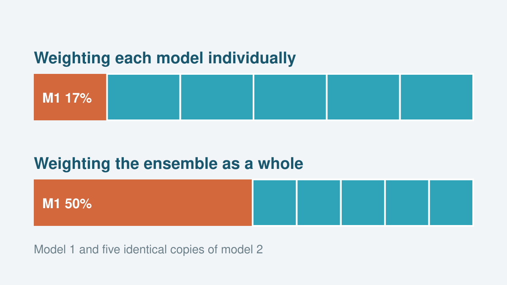

::: {.we-box}
[Adding copies of a model to the ensemble]{.we-box-title}

<noscript></noscript>

::: {.we-caption}
A toy ensemble of model 1 and $n_2$ identical copies of model 2, weighted against observations in two ways. With individual weighting, each copy receives the same weight as the original, so that the copies together outweigh model 1. With ensemble weighting, the weighted mean is the same however the weight of model 2 is split among its copies, so that model 1 keeps its weight.
:::
:::

## Two ways to weight an ensemble

Multi-model ensembles such as CMIP are ensembles of opportunity. They contain the models that modeling centers chose to run, and many of these share components, parameterizations or entire code bases. The simplest way to combine them is to give each model the same weight (i.e., model democracy). However, this gives more influence to groups of related models and ignores that some models reproduce the observations better than others. Most weighting methods in use therefore combine a weight based on the performance of each model with a weight based on its independence from the other models (e.g., Brunner et al., 2020). The independence weight requires a measure of the distance between models and a parameter that sets which distance counts as dependent.

We distinguish two families of methods. In individual performance weighting (IPW), the weight of each model $M_i$ is proportional to its likelihood given the observations $Y$, times its prior probability,

$$
w_i \propto P(Y \mid M_i)\, P(M_i).
$$

In ensemble performance weighting (EPW), the weights are instead the parameters of a single combined model, the weighted mean $m^* = \sum_i w_i\, m_i$. The result is a posterior distribution over weight vectors,

$$
P(\mathbf{w} \mid Y) \propto P(Y \mid m^*)\, P(\mathbf{w}),
$$

where $P(\mathbf{w})$ is the prior over the weights. In other words, IPW measures how well each model reproduces the observations relative to the others, while EPW finds the combination of models that best reproduces them.

## Duplicate models add no information

To test how each approach handles dependence, we constructed ensembles of one model and $n_2$ identical copies of a second model. Since the copies add no information, neither the weight of model 1 nor the summed weight of the copies should change with increasing values of $n_2$. We used three examples: two synthetic models with complementary errors, two synthetic models with independent errors, and two CMIP6 models (AWI-CM-1-1-MR and CESM2-WACCM) compared with ERA5.

IPW fails this test in all three examples. Each copy performs as well as the original and thus receives the same weight. For two models of similar performance, the mean weight of model 1 decreases to $1/(n_2 + 1)$, thus becoming very small with increasing $n_2$ (Fig. 6a–c). In contrast, EPW keeps both the mean weight of model 1 and the sum of the mean weights of the copies constant (Fig. 6d–f). This is a direct consequence of weighting the mean. The weighted mean depends only on the total weight of the copies and not on how it is split among them. The observations therefore constrain only the sum, and the posterior weights of the copies are strongly anticorrelated (when one copy has a large weight, the other copies need to have low weights). Thus, EPW accounts for dependence implicitly, without a measure of model distance or any additional parameter.

![Fig. 6 of the paper. Mean posterior weights of model 1 (red), of all copies of model 2 (solid blue) and of a single copy of model 2 (dashed blue) as a function of the number of copies $n_2$, using (a–c) the individual and (d–f) the ensemble performance weighting approach. The three columns show the toy example with complementary errors, the toy example with independent errors and the example with two CMIP6 models. Numbers in brackets give the area-weighted root mean squared errors of the two models with respect to the observations. [Grusdt et al. (2026), *Earth System Dynamics*, [CC BY 4.0](https://creativecommons.org/licenses/by/4.0/).]{.hl-credit}](fig6.png){fig-alt="Model weights against the number of copies of model 2 for individual and ensemble performance weighting"}

This implicit treatment applies to dependence that is visible in the diagnostics used for weighting. Two models with similar process representations but different outputs are treated as independent and no assumption about which models are related is needed. Note also that a single weight vector sampled from the posterior is not a ranking of the models. Only the posterior mean reflects the average contribution of each model to the weighted mean.

## The prior controls the uncertainty

EPW requires a prior over weight vectors, for which we use a symmetric Dirichlet distribution with concentration parameter $\alpha$ (i.e., each element in the parameter vector $\boldsymbol{\alpha}$ has the same scalar value $\alpha$). For any $\alpha$, the expected weight of each model is $1/N$, where $N$ is the number of models. The magnitude of $\alpha$ determines how far individual weight vectors depart from equal weights. For $\alpha = 1$, the sampled weights are spread over many models, so that the prior-weighted mean hardly departs from the unweighted multi-model mean. For $\alpha < 1$, most of the weight falls on a few models, and as $\alpha$ approaches zero the weight vectors approach the selection of a single model.

This choice matters because the posterior range of the weighted mean cannot extend beyond the range allowed by the prior. With $\alpha = 1$, the prior-weighted mean of 38 models is already confined to a narrow interval around the multi-model mean. A narrow posterior then reflects the prior rather than the observations. We therefore recommend $\alpha = 1/N$, for which the prior-weighted mean covers most of the spread of the ensemble. In addition, we propose two minimum requirements for reporting weighted projections: (1) projections based on the prior weights alongside those based on the posterior weights and (2) prior predictive checks showing that the prior-weighted diagnostics cover the ensemble.

The explorer below draws weight vectors from the Dirichlet prior for 38 synthetic models, sampled from a normal distribution with a mean of 3 and a standard deviation of 1 (as in Fig. 1b of the paper). Start with $\alpha = 1/N$ and then compare $\alpha = 1$ and $\alpha = 1/500$.

::: {.we-box}
[Prior weights for an ensemble of 38 models]{.we-box-title}

:::

Even with a suitable prior, the posterior range of EPW only represents the uncertainty in the weights. It does not include internal variability, observational uncertainty or errors that all models have in common. EPW thus tends to reduce the uncertainty artificially. For a small ensemble of opportunity, a narrow posterior range should therefore not be read as a narrow range of possible climate outcomes.

## Which approach for which purpose

The two approaches answer different questions. EPW gives the combination of models that best reproduces the observations, which makes it suited to estimating a weighted ensemble mean. IPW gives the relative performance of each model, which makes it suited to ranking models. Since EPW is a linear combination, it cannot represent nonlinear combinations of models. The choice of method should thus follow from the purpose of the weighted ensemble.

::: {.callout-note collapse="true" appearance="simple"}
## How the interactive figures work

The toy ensembles at the top are those of Sect. 5 of the paper, based on 1980–2014 mean near-surface air temperature anomalies relative to the global mean on a 5° grid. In the first two examples, the models are constructed from the ERA5 observations and Gaussian errors with a standard deviation of 2. These errors are a new random draw, so that the weights differ slightly from those in Fig. 6. The third example uses the output of the two CMIP6 models. The weights are computed on the full grid, while the plot shows the mean over all latitudes at each longitude, which makes the errors look smaller than they are. For IPW, the weights are proportional to the inverse area-weighted mean squared error of each model, as in the paper. For EPW, the prior is a Dirichlet distribution with $\alpha = 1/N$, the likelihood of the weighted mean is Gaussian, and the error variance $\sigma^2$ has an inverse-gamma prior,

$$
\mathbf{w} \sim \mathrm{Dir}(1/N), \qquad \sigma^2 \sim \mathrm{InvGamma}(2, 3), \qquad y_v \sim \mathcal{N}(m^*_v, \sigma^2 / a_v),
$$

where $y_v$, $m^*_v$ and $a_v$ are the observations, the weighted mean and the normalized area weight at grid point $v$. Since the weighted mean depends only on the weight of model 1 and the summed weight of the copies, the posterior reduces to one dimension. Its prior is $\mathrm{Beta}(1/N, n_2/N)$ by the aggregation property of the Dirichlet distribution, and $\sigma^2$ is integrated out analytically. This allows the posterior mean to be computed in the browser by numerical integration over a grid of values for the weight of model 1, while the paper samples the full posterior with MCMC. The prior explorer draws 5,000 weight vectors for each value of $\alpha$. The source code is [here](we.js).
:::

::: {.hl-cite}
[The paper]{.hl-cite-heading}

Grusdt, B., Perrette, M., and Robinson, A.: On combining climate models into weighted ensembles, *Earth System Dynamics*, 17, 1589–1607, [doi.org/10.5194/esd-17-1589-2026](https://doi.org/10.5194/esd-17-1589-2026), 2026. [Open access]{.pub-status}

[<i class="bi bi-file-earmark-text"></i> Paper](https://doi.org/10.5194/esd-17-1589-2026){.repo-link}
[<i class="bi bi-database"></i> Code and data (Zenodo)](https://doi.org/10.5281/zenodo.23334598){.repo-link}
[<i class="bi bi-github"></i> awi-esc/WeightedEnsembles](https://github.com/awi-esc/WeightedEnsembles){.repo-link}
[<i class="bi bi-github"></i> awi-esc/ModelWeights.jl](https://github.com/awi-esc/ModelWeights.jl){.repo-link}
:::

