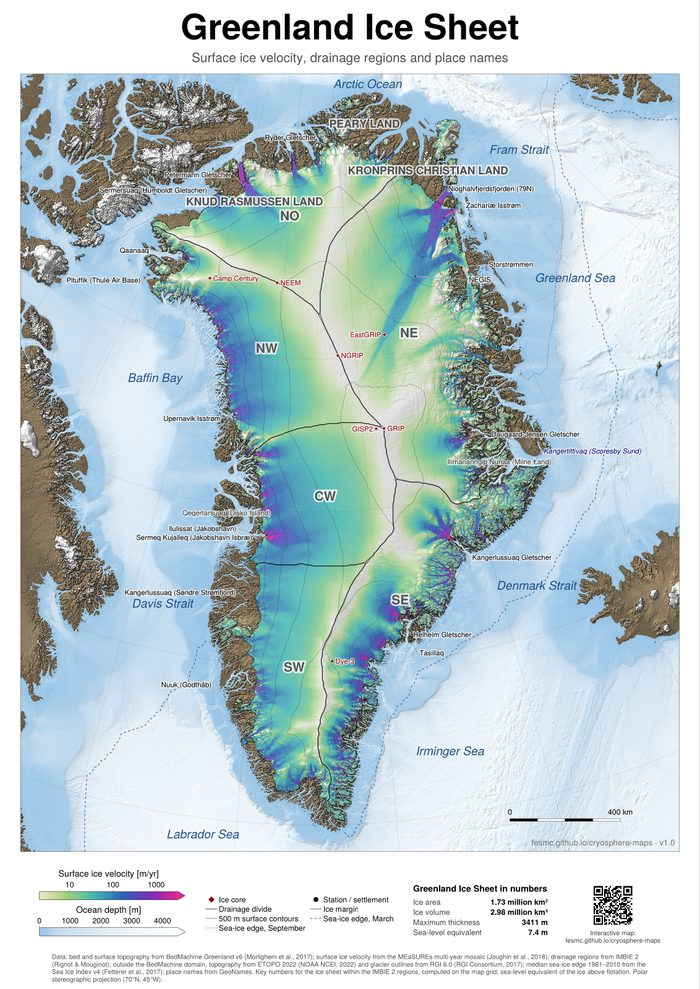

Material produced by our group that may be useful beyond our own research.

::: {.resource-card}
::: {.resource-thumb}
[{fig-alt="Poster map of the Greenland ice sheet showing surface ice velocity"}](https://fesmc.github.io/cryosphere-maps/)
:::

::: {.resource-body}
### Cryosphere maps

Poster maps of the Greenland and Antarctic ice sheets, showing surface ice
velocity over shaded topography, drainage regions, the sea-ice edge and place
names. The collection also includes maps of the Northern Hemisphere and
Antarctic ice sheets at the Last Glacial Maximum, as well as vintage-style maps
with expedition routes and wildlife. All maps are generated from published
datasets with Julia and CairoMakie. The website provides interactive versions
and printable posters in A0 format.

[<i class="bi bi-map"></i> Interactive maps and posters](https://fesmc.github.io/cryosphere-maps/){.repo-link}
[<i class="bi bi-github"></i> fesmc/cryosphere-maps](https://github.com/fesmc/cryosphere-maps){.repo-link}
:::
:::
